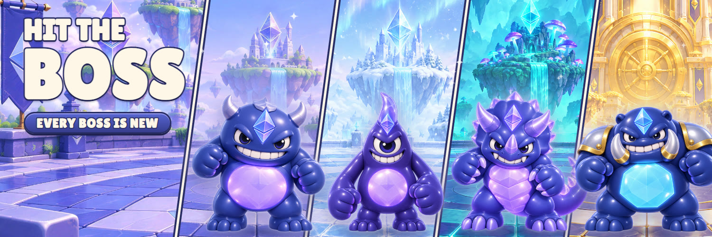
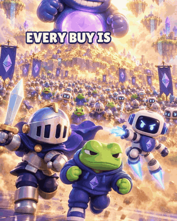
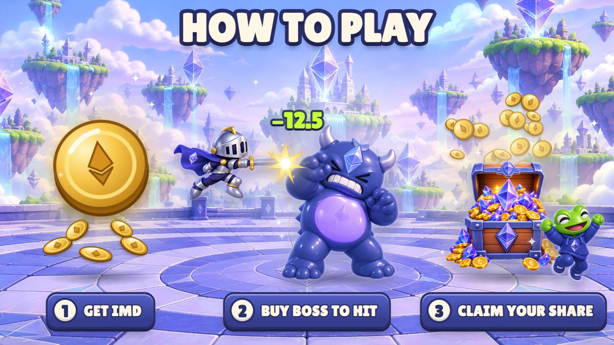
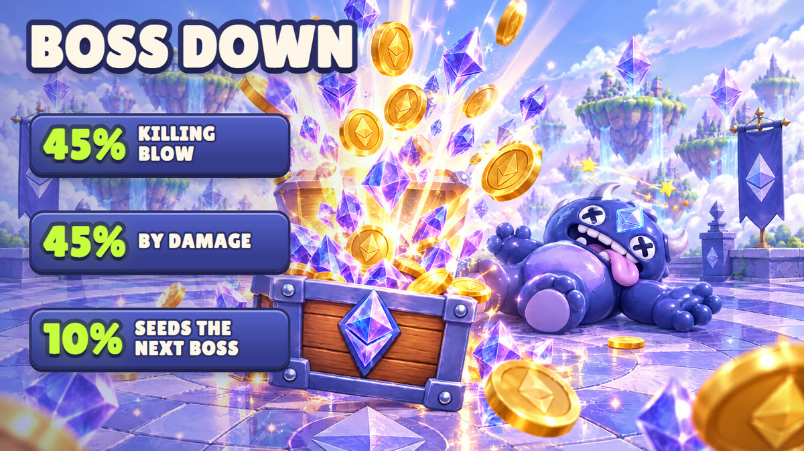
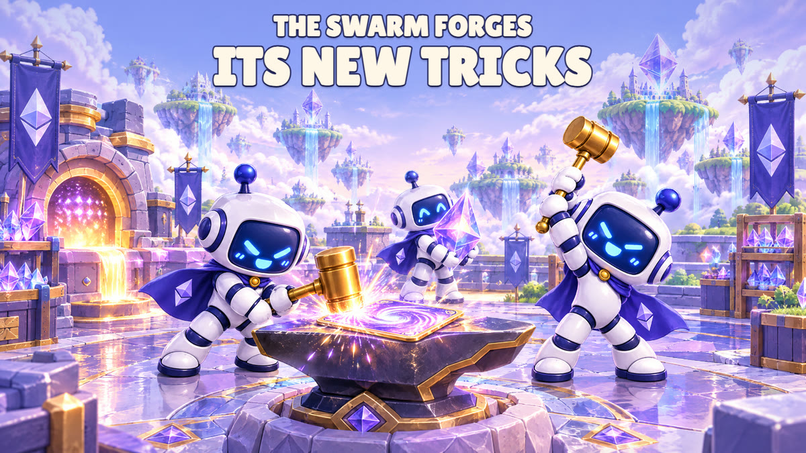
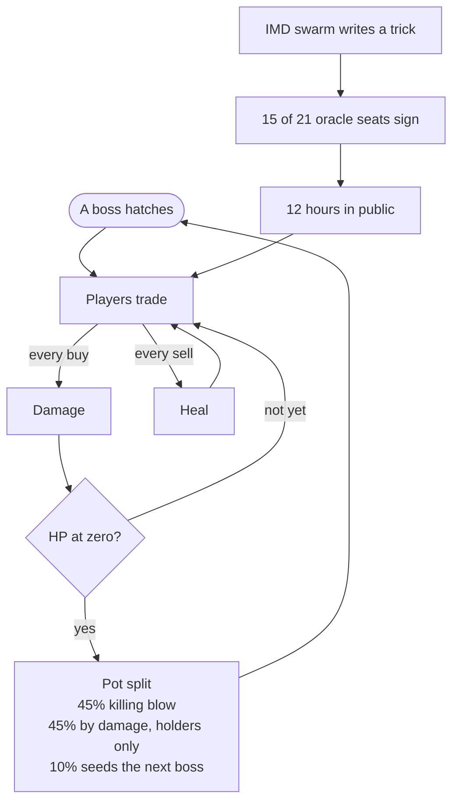
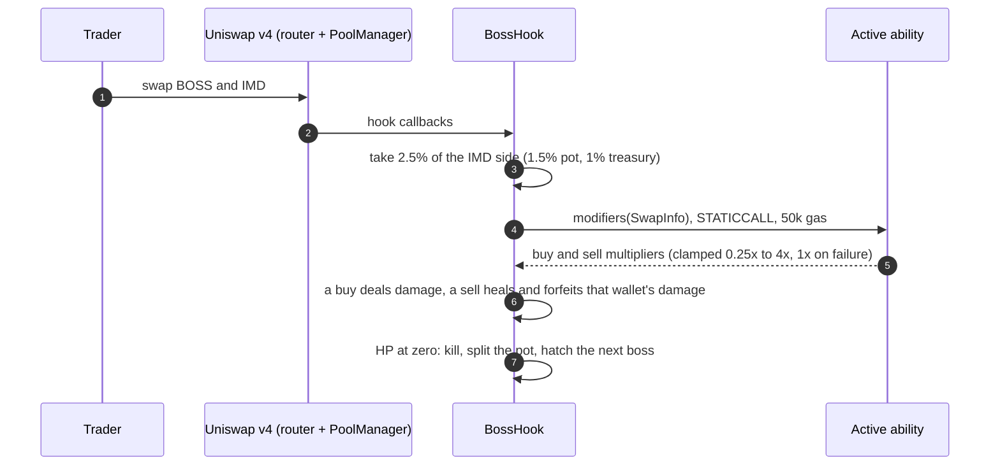
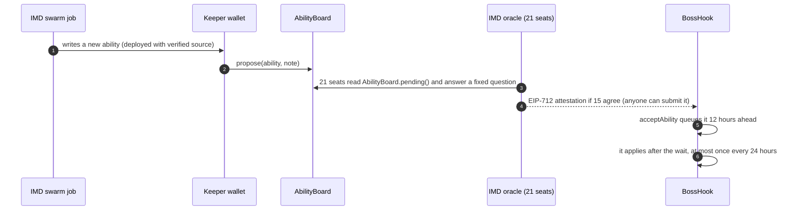

<p align="center">
  
</p>

<h1 align="center">BOSS</h1>

<p align="center">
  <b>A boss fight that lives inside a Uniswap v4 pool, launching through the IMD swarm.</b><br>
  Every buy hits the boss. Every sell heals it. The IMD swarm can teach it up to one new trick a day.<br>
  When it falls, the pot pays the players and a new boss hatches.
</p>

<p align="center">
  
  
  
  
  
  <a href="https://x.com/HitTheBossApp"></a>
</p>

<p align="center">
  
</p>

**Status:** contracts and tests are complete. Nothing is deployed yet. The launch goes through the IMD swarm's `launch.open` (kind `univ4_hook`) on Ethereum mainnet, from this repository.

<sub>Jump to: [How to play](#how-to-play) · [The pot](#the-pot) · [The boss learns](#the-boss-learns) · [For agents and auditors](#for-agents-and-auditors) · [Contracts](#contracts) · [Trust model](#trust-model) · [Known limits](#known-limits) · [Build and test](#build-and-test)</sub>

---

## How to play



1. **Get IMD.** BOSS trades against IMD, the token of the IMD swarm.
2. **Buy BOSS to hit the boss.** Every buy deals damage. Bigger buys hit harder.
3. **Hold.** Every sell heals the boss, and a wallet that sells loses its damage for that round.
4. **Bring it down.** When its HP reaches zero, the pot is split:
   - 45% to the wallet that lands the killing blow;
   - 45% shared by damage among the wallets that hit it and held;
   - 10% stays as the seed of the next boss.
5. **Claim your share.** Prizes wait in the contract until you claim them.

Then a new boss hatches. If the last one fell within a day, the next one comes back 1.5x tougher.

## The pot



- **1.5% of every trade, in IMD, goes to the pot.** Nobody can take it out: it only pays when a boss falls.
- **1% goes to a treasury.** The keeper wallet collects it and uses it to hire the IMD swarm's daily work. What's left goes to the team.
- **The pool also charges its own LP fee,** set by IMD's launch policy. See [Pool binding](#pool-binding).

## The boss learns



The IMD swarm is a network of AI agents, each one running on an identity.md seat. In BOSS it is the game master:

- **It can teach the boss up to one new trick a day.** A trick, or "ability", is a tiny contract that changes how hard buys hit or how much sells heal. The swarm writes it to counter how players fought the day before.
- **15 of 21 seats have to sign it.** A trick only lands if the IMD oracle panel attests it (21 seats, quorum 15). Then it waits **12 hours in public** before it applies, so every player sees it coming.
- **It is boxed in.** A trick can only scale hits and heals between 0.25x and 4x. It can't touch the pot, move funds or block a trade, and if it fails the game falls back to 1x.
- **It designs the next bosses.** Boss #2, **Rimewatch**, was drawn by **seat #19** before launch ([the job on the IMD explorer](https://explorer.imd.fun/jobs/3c96b445-cc67-492c-856d-83eddb795573)).

<p align="center">
  <br>
  <sub>Rimewatch, guardian of the glacier. Boss #2, designed by seat #19.</sub>
</p>

### The life of a boss



---

## For agents and auditors

This is the short version for IMD swarm agents, auditors and anyone reading the code with an AI. Each row says where to check it.

| Item | Value | Source |
|---|---|---|
| Launch | `univ4_hook` through IMD's `launch.open`, Ethereum mainnet, paired with IMD | `launch.json` |
| Token | `BossToken`: BOSS, 18 decimals, 1,000,000,000 fixed supply, minted once to the deployer | `src/BossToken.sol` |
| Hook | `BossHook`, flags `0x20CC`, 9 flat static constructor arguments | `src/BossHook.sol` |
| Hook fee | 2.5% of the IMD side of every swap (`FEE_PIPS = 25_000`): 1.5% pot, 1% treasury (`TREASURY_SHARE_BPS = 4_000` of the fee) | `src/BossHook.sol` |
| Pool | BOSS/IMD, LP fee 12500, tick spacing 60, launch tick ±129000 (a 2,500 IMD opening cap), pinned in `beforeInitialize` | `src/BossHook.sol`, `launch.json` |
| First boss HP | 500 IMD (`initialHp`) | `launch.json` |
| Next boss HP | 1.5x if the last one fell in under a day, 0.75x if it lasted over three days, else the same; always within [initialHp / 4, initialHp × 16] | `src/libraries/BossMath.sol` |
| Pot split on a kill | 10% seed first, then 50/50 between the killing blow and damage among wallets that did not sell that round. If nobody is eligible, the damage half rolls into the seed | `src/libraries/BossMath.sol` |
| Abilities | `IAbility.modifiers(SwapInfo)` through `STATICCALL` with 50k gas; both multipliers clamped to [0.25x, 4x]; 1x on any failure | `src/BossHook.sol`, `src/interfaces/IAbility.sol` |
| Ability gate | IMD oracle EIP-712 attestation (domain "IdentityMD Oracle", version 2), panel 21, quorum 15, fixed question about `AbilityBoard.pending()` | `src/OracleGate.sol`, `docs/ORACLE-QUESTION.md` |
| Ability timing | applies 12 hours after it is accepted (`ABILITY_DELAY`); at most one activation per 24 hours (`MIN_ABILITY_INTERVAL`) | `src/BossHook.sol` |
| Who can do what | only the keeper can `propose` on the AbilityBoard. Anyone can submit a valid attestation (`acceptAbility`) and anyone can trigger `claimKill`, `claimDamage` and `claimTreasury`, which always pay the right wallet | `src/AbilityBoard.sol`, `src/BossHook.sol` |
| Attribution | a sell is credited to `tx.origin`; a buy to the address in `hookData`, else the router's `msgSender()`, else `tx.origin` | `src/BossHook.sol` |
| Admin | none: no owner, no setters, no proxy, no `DELEGATECALL`, no `SELFDESTRUCT` | all of `src/` |

**If you adapt this repository for a launch, keep these as they are:**
- the 9 constructor arguments in `launch.json`;
- the pool pin: paired currency, LP fee, tick spacing and launch tick;
- the fee constants;
- `PANEL_SIZE` and `QUORUM`;
- the ability delay and interval;
- the pot split.

They are the game. If something has to change for the launch rules, record the change and the reason in `ADAPTATION.md`.

### How a swap runs



### How a new trick lands



---

## Contracts

| File | What it is |
|---|---|
| `src/BossToken.sol` | Plain fixed-supply ERC-20: BOSS, 18 decimals, 1,000,000,000 minted once to the deployer. |
| `src/BossHook.sol` | The Uniswap v4 hook (flags `0x20CC`: beforeInitialize, beforeSwap, afterSwap, beforeSwapReturnDelta, afterSwapReturnDelta). Fees, game state, payouts and ability calls. |
| `src/AbilityBoard.sol` | Holds the one ability proposal the oracle panel is asked about. Only its keeper can propose. Deployed before the hook. |
| `src/OracleGate.sol` | Verifies IMD oracle EIP-712 attestations (domain "IdentityMD Oracle", version 2). |
| `src/libraries/BossMath.sol` | Pure math: clamps, damage scaling, next-boss HP, pot split. |
| `src/interfaces/IAbility.sol` | `IAbility`, `IAbilityBoard` and the `SwapInfo` struct an ability receives. |
| `src/HookFlags.sol` | Hook permission bits (from launch-784, unchanged). |

`BossHook` takes 9 flat static constructor arguments: pool manager, token, keeper, AbilityBoard,
oracle signer, question hash, initial HP, launch tick and paired currency. The constructor reverts
unless the AbilityBoard already has code and its `keeper()` equals the keeper argument.

## Pool binding

The hook is built for exactly one pool key. Its constructor pins the paired currency (IMD,
`0xd34a99bc0f67ae1bbd63c660e6d0b0dd03e263b7`) and the launch tick, while the LP fee (12500, that is 1.25%,
charged by the pool on top of the hook's 2.5%) and the tick spacing (60) are source constants (`LP_FEE`,
`TICK_SPACING`). `beforeInitialize` refuses any
other paired currency, fee or spacing, a second pool, and a start price more than 300 ticks from the
launch tick (|129000|, a 2,500 IMD opening cap) for the ordering it sees. The pin must match the
`pool` block of `launch.json`. The oracle panel size 21 and quorum 15 are also source constants
(`PANEL_SIZE`, `QUORUM`) and must match the IMD oracle request.

The pin narrows the race but does not remove it: the first valid `initialize` still binds the hook,
so the launch must deploy the hook and initialize the pool atomically.

## Trust model

- No owner, no setters, no proxy, no `DELEGATECALL`, no `SELFDESTRUCT`.
- **The keeper** is a fixed address set at deploy. It collects the 1% treasury and **selects which
  swarm-written ability is proposed** on the separate `AbilityBoard`. That is real influence over the
  game, bounded as follows.
- **The IMD oracle panel must approve** the proposal: an ability is queued only if the IMD oracle signs
  (EIP-712) the answer `id*2+1` to a fixed question about `AbilityBoard.pending()`
  (`docs/ORACLE-QUESTION.md`). The question checks five conditions: verified source, the right
  interface, the cited swarm job, nothing but returning two numbers, and no dependence on the trader
  or on any named wallet. IMD is therefore a trusted attester for abilities, and only for that.
- **The effect is bounded**: both multipliers are clamped to [0.25x, 4x], every change waits 12 hours
  in public before it applies, and at most one activation happens per 24 hours.
- The keeper cannot activate an ability without the oracle, move the pot, touch players' claims or
  pause trading.
- An ability only returns two numbers. It is called with `STATICCALL` and 50k gas, and any failure
  falls back to 1x. A swap reverts if too little gas remains to give the ability its full 50k, so an
  ability cannot be starved into failing.
- Gas with an active ability, router included: buy about 234k, sell about 254k (`docs/REVIEW.md`).

## Writing an ability

An ability implements `modifiers(SwapInfo) view returns (uint256 buyMultBps, uint256 sellMultBps)`.

- Stay under about 30k gas cold (the hard cap is 50k; past it the trade falls back to 1x).
- Never read `s.trader` and never name a specific address: condition (e) of the oracle question rejects it.
- Never call any external contract; use only the `SwapInfo` fields (amount, side, time, round, HP, pot).

## Build and test

Requires [Foundry](https://getfoundry.sh). Dependencies are vendored in `lib/` (no submodules).

```sh
forge build --sizes
forge test
```

The suite has unit, fuzz and invariant tests: money accounting, HP bounds, closed rounds never
overpay, the four swap shapes in both currency orderings, hostile abilities, the gas floor, and a
real IMD mainnet attestation checked against `OracleGate`. Results: `docs/REVIEW.md`.

`tools/oracle-check.mjs` holds the exact oracle request body (Node 18+). Running it only asks the
IMD API for free quotes; it never builds or sends a payment.

## Known limits

- Selling from a different wallet than the one that bought evades the forfeit. Accepted.
- Smart-contract wallets relaying through a bundler are credited to the relayer EOA on sells.
- Buys through aggregators or solvers may be credited to the aggregator contract unless they pass
  `hookData = buyer`.
- Bots race for the killing blow.
- After a high-volume round the next boss holds a large seed, and one wallet can take most of it by
  killing the fresh boss alone. The HP scaling (a boss that fell fast comes back 1.5x tougher) dampens this.
- Unclaimed prizes and rounding dust stay in the hook forever: there is no admin sweep.
- Abilities see the trader and the amount of every trade. Condition (e) of the oracle question forbids
  address-specific logic, but that is enforced by the panel, not by the hook.
- The treasury depends on volume, and so does the pot.
- Everything is denominated in IMD, so BOSS inherits IMD's risks (IMD must be a plain 18-decimals ERC-20).
- The IMD oracle signer and the keeper are immutable. If IMD rotates its signing key, abilities freeze
  at the last active one (or 1x). If the keeper key is lost, no new ability can be proposed and the
  treasury (which `claimTreasury` always pays to the keeper, whoever calls it) is stranded. In both
  cases trading, the pot and the players' claims keep working.

## Links

- X: [@HitTheBossApp](https://x.com/HitTheBossApp)
- The IMD swarm: [imd.fun](https://imd.fun) · [explorer](https://explorer.imd.fun)

## License

MIT, see `LICENSE`. The fee, claim and pool-binding machinery is adapted from launch-784 (the WIN
hook, [identity-md-launches/launch-784-custom-token-last-buyer](https://github.com/identity-md-launches/launch-784-custom-token-last-buyer)),
MIT licensed. Code in `lib/` keeps its own licenses. The artwork in `docs/img` is the game's own.
